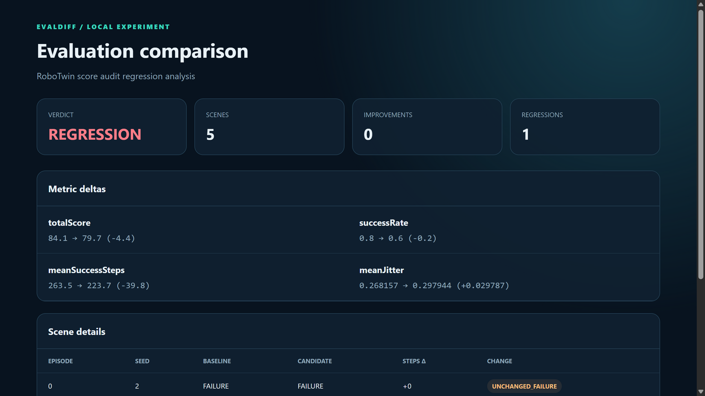

# eval-diff

一个用于比较两次 RoboTwin 评测结果的 Java 17 命令行工具。它不只比较总分，还会定位到具体场景：哪些从成功变成失败、哪些任务被恢复、成功场景的步数是增加还是减少，并生成适合归档的 JSON 和 HTML 报告。

> 示例数据来自本地历史实验，不是官方排行榜成绩。工具可以接入任何遵循相同 `score_audit` 数据契约的实验流程。

## 功能

- 校验 baseline 与 candidate 的 episode 和 seed 是否一一对应，拒绝不公平比较。
- 识别 `IMPROVEMENT`、`REGRESSION`、`FASTER`、`SLOWER` 和未变化场景。
- 对比总分、成功率、平均成功步数和平均 Jitter。
- 保守的总体判定：出现成功场景回归或核心指标下降时返回 `REGRESSION`。
- 同时输出控制台摘要、机器可读 JSON 和无外部依赖的 HTML 报告。
- 使用退出码接入 CI，在候选模型退化时阻止发布。

## 构建与运行

要求 JDK 17 和 Maven 3.9+：

```bash
mvn clean verify
java -jar target/eval-diff-1.0.0.jar \
  examples/baseline.json examples/candidate.json \
  --json reports/comparison.json \
  --html docs/sample-report.html
```

示例数据的真实输出包括：

```text
Verdict: REGRESSION
Scenes: 5 | improvements: 0 | regressions: 1 | faster: 1 | slower: 1
totalScore         84.1 -> 79.7 (-4.4)
successRate        0.8 -> 0.6 (-0.2)
meanSuccessSteps   263.5 -> 223.7 (-39.8)

episode 2 / seed 4: SUCCESS -> FAILURE, steps 384 -> 400
```

平均成功步数下降并不自动意味着模型更好：失败场景不会进入成功步数均值，必须同时查看成功率和逐场变化。这正是这个工具要展示的分析方式。

## 退出码

| 退出码 | 含义 | CI 用途 |
|---|---|---|
| `0` | 改善或没有核心退化 | 允许通过 |
| `1` | 检测到回归 | 阻止候选发布 |
| `2` | 输入、数据契约或参数错误 | 修正调用或数据 |

## 数据格式

输入为包含 `episode_records` 和 `score` 的 JSON：

```json
{
  "episode_records": [
    {"episode": 0, "seed": 2, "success": false, "steps": 400, "jitter": 0.3}
  ],
  "score": {
    "total": 79.7,
    "success_rate": 0.6,
    "mean_success_steps": 223.7,
    "mean_jitter": 0.297944
  }
}
```

未知字段会被忽略，因此可以保留原始计分函数的其他分项。完整可运行示例位于 `examples/`。

## 测试

```bash
mvn clean verify
```

测试覆盖真实对照数据、正向/反向比较、回归退出码、HTML/JSON 生成及参数错误。GitHub Actions 会使用 JDK 17 执行同一套验证。

## 简历表述

> 使用 Java 17 和 Jackson 独立实现模型评测对比 CLI，通过 episode/seed 数据契约校验保证可比性，设计逐场回归分类和指标差值分析，输出控制台、JSON 与 HTML 报告，并以退出码支持 CI 发布门禁。
